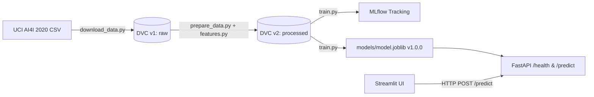

# AI4I 2020 Predictive Maintenance (MLOps Coursework)

Воспроизводимый MLOps-пайплайн для прогнозирования отказов промышленного оборудования в реальном времени на базе датасета **UCI AI4I 2020 Predictive Maintenance**.

Репозиторий: `https://github.com/ilyakoptilin/mlops-coursework`  
Документация проекта: [`DATASET_CARD.md`](DATASET_CARD.md) | [`MODEL_CARD.md`](MODEL_CARD.md) | [`REPORT.md`](REPORT.md)

---

## 1. Архитектура ML-пайплайна и сервиса



## 2. Архитектура Continuous Integration (GitHub Actions)


---

## 3. Требования к окружению и восстановление зависимостей

* **Python:** `3.12`
* **Менеджер пакетов:** `uv` (`>= 0.5.11`)
* **Контейнеризация:** Docker (`>= 24.0`)

Клонирование репозитория и установка зафиксированных зависимостей из `uv.lock`:

```bash
git clone https://github.com/ilyakoptilin/mlops-coursework.git
cd mlops-coursework
cp .env.example .env
uv sync --frozen
```

---

## 4. Данные, обучение и воспроизведение экспериментов

Конфигурация разделена на секции `train` и `inference` в файле [`configs/config.yaml`](configs/config.yaml).

1. **Получение данных и генерация признаков (версии `v1` и `v2` зафиксированы в `.dvc`):**
   ```bash
   uv run python src/mlops_coursework/download_data.py
   uv run python src/mlops_coursework/prepare_data.py
   ```
2. **Обучение 3 моделей и логирование в MLflow (`sqlite:///mlflow.db`):**
   ```bash
   uv run python src/mlops_coursework/train.py
   ```

| Модель | Accuracy | Precision | Recall | F1-score | ROC-AUC | PR-AUC |
| :--- | :---: | :---: | :---: | :---: | :---: | :---: |
| Logistic Regression | 0.8585 | 0.1791 | 0.8824 | 0.2978 | 0.9385 | 0.4297 |
| Random Forest | 0.9795 | 0.6588 | 0.8235 | 0.7320 | 0.9829 | 0.8536 |
| **HistGradientBoosting (Best)** | **0.9845** | **0.7342** | **0.8529** | **0.7891** | **0.9809** | **0.8929** |

---

## 5. Запуск тестов и проверка покрытия

```bash
uv run ruff check src tests
uv run pytest -v --cov=mlops_coursework --cov-fail-under=80
```

---

## 6. Сборка и запуск в Docker

Образ собирается из зафиксированного базового образа `python:3.12-slim`, автоматически воспроизводит обучение модели при сборке (работает на чистой машине без локальных артефактов) и запускает сервис от имени непривилегированного пользователя `appuser`:

```bash
docker build -t ai4i-maintenance-api:v1.0.0 .
docker run -d --name ai4i-api -p 8000:8000 ai4i-maintenance-api:v1.0.0
```

Swagger UI доступен по адресу: `[http://127.0.0.1:8000/docs](http://127.0.0.1:8000/docs)`.

---

## 7. Примеры запросов к API и запуск Streamlit UI

**Проверка готовности сервиса (`GET /health`):**
```bash
curl -s http://127.0.0.1:8000/health
```
Ответ:
```json
{"status":"ok","model_loaded":true,"model_version":"v1.0.0"}
```

**Запрос предсказания (`POST /predict`):**
```bash
curl -s -X POST http://127.0.0.1:8000/predict \
  -H "Content-Type: application/json" \
  -d '{"machine_type":"L","air_temp_k":302.5,"process_temp_k":310.1,"rotational_speed_rpm":1320,"torque_nm":68.5,"tool_wear_min":225}'
```
Ответ:
```json
{"failure_prediction":1,"failure_probability":0.9999,"risk_level":"high","model_version":"v1.0.0"}
```

**Запуск пользовательского интерфейса (Streamlit UI):**
Веб-интерфейс взаимодействует с запущенным FastAPI-сервисом по HTTP (`API_URL`, по умолчанию `[http://127.0.0.1:8000](http://127.0.0.1:8000)`):
```bash
uv run streamlit run src/mlops_coursework/ui.py
```

---

## 8. Структура репозитория

```text
├── .github/workflows/ci.yml      # CI: Ruff, Pytest + Coverage, Docker build & smoke test
├── configs/config.yaml           # Конфигурация секций train и inference
├── data/                         # Метаданные версий данных DVC (v1 и v2)
├── docs/                         # Скриншоты MLflow, CI и Swagger UI
├── src/mlops_coursework/
│   ├── features.py               # Валидация конфига и единый расчёт признаков
│   ├── download_data.py          # Загрузка сырого датасета
│   ├── prepare_data.py           # Очистка от утечек и генерация признаков
│   ├── train.py                  # Обучение моделей и логирование в MLflow
│   ├── api.py                    # REST API на FastAPI (/health, /predict, /docs)
│   └── ui.py                     # Клиентский интерфейс на Streamlit
├── tests/                        # Юнит- и интеграционные тесты (coverage > 90%)
├── .dockerignore
├── .env.example
├── Dockerfile
├── DATASET_CARD.md
├── MODEL_CARD.md
├── REPORT.md
├── pyproject.toml
└── uv.lock
```
