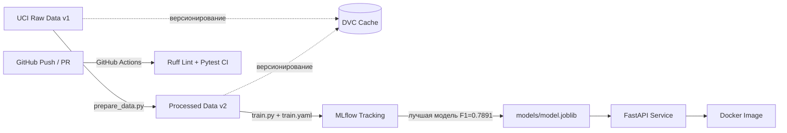
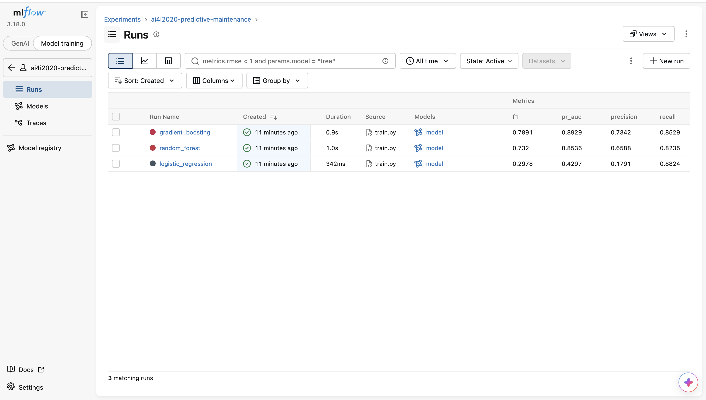

# AI4I 2020 Predictive Maintenance — End-to-End MLOps Pipeline

Сквозной MLOps-пайплайн для прогнозирования отказов промышленного оборудования по телеметрии датчиков на базе датасета **UCI AI4I 2020 Predictive Maintenance**.

## Архитектура системы



## Структура репозитория

```text
├── .github/workflows/ci.yml        # Автоматический CI (линтер Ruff + тесты Pytest)
├── configs/train.yaml              # Гиперпараметры моделей и пути артефактов
├── data/
│   ├── raw/ai4i2020.csv.dvc        # Паспорт сырых данных v1 (DVC)
│   └── processed/...csv.dvc        # Паспорт обработанных данных v2 (DVC)
├── docs/                           # Скриншоты экспериментов MLflow и GitHub Actions CI
├── models/metrics.json             # Сводный отчёт метрик всех моделей
├── src/mlops_coursework/
│   ├── download_data.py            # Загрузка сырого датасета
│   ├── prepare_data.py             # Очистка от утечек и генерация признаков
│   ├── train.py                    # Обучение 3 моделей и логирование в MLflow
│   └── api.py                      # REST API сервис прогнозирования (FastAPI)
├── tests/
│   ├── conftest.py                 # Фикстура тестовой модели для облачного CI
│   └── test_api.py                 # Интеграционные тесты эндпоинтов
├── Dockerfile                      # Сборка контейнера инференс-сервиса
└── pyproject.toml                  # Зависимости проекта (управление через uv)
```

## Карточка данных (Dataset Card)

* **Источник:** UCI Machine Learning Repository — AI4I 2020 Predictive Maintenance Dataset (10 000 записей, 14 исходных признаков).
* **Дисбаланс классов:** доля отказов (`target = 1`) составляет **3.39%** (339 аварийных случаев). При разбиении на `train`/`test` (80/20) применена стратификация (`stratify=y`), а во всех алгоритмах активирована балансировка весов (`class_weight="balanced"`).
* **Версии данных в DVC:**
  * `v1` (`data/raw/ai4i2020.csv`): исходная таблица без изменений.
  * `v2` (`data/processed/ai4i2020_processed.csv`): удалены идентификаторы (`UDI`, `Product ID`) и колонки расшифровки причин отказа (`TWF`, `HDF`, `PWF`, `OSF`, `RNF`) во избежание утечки данных (*Data Leakage*); добавлены 3 физических признака:
    * `temp_diff_k` — перегрев узла ($\text{Process temp} - \text{Air temp}$);
    * `power_w` — механическая мощность в Ваттах ($\tau \cdot \omega$);
    * `overstrain_index` — индекс перегрузки инструмента ($\tau \cdot \text{Tool wear}$).

## Результаты экспериментов и карточка модели (Model Card)

Все эксперименты залогированы в **MLflow** (`sqlite:///mlflow.db`). В качестве целевой метрики выбран **F1-score** (баланс полноты выявления аварий и точности срабатываний) совместно с **PR-AUC**.

| Модель | Accuracy | Precision | Recall | F1-score | ROC-AUC | PR-AUC |
| :--- | :---: | :---: | :---: | :---: | :---: | :---: |
| Logistic Regression (Baseline) | 0.8585 | 0.1791 | 0.8824 | 0.2978 | 0.9385 | 0.4297 |
| Random Forest | 0.9795 | 0.6588 | 0.8235 | 0.7320 | 0.9829 | 0.8536 |
| **HistGradientBoosting (Winner)** | **0.9845** | **0.7342** | **0.8529** | **0.7891** | **0.9809** | **0.8929** |



## Быстрый старт

### 1. Локальный запуск через `uv`

```bash
uv sync
uv run python src/mlops_coursework/download_data.py
uv run python src/mlops_coursework/prepare_data.py
uv run python src/mlops_coursework/train.py
uv run uvicorn mlops_coursework.api:app --host 0.0.0.0 --port 8000
```

### 2. Проверка качества кода и автотестов

```bash
uv run ruff check src tests
uv run pytest -v
```

### 3. Запуск в Docker

```bash
docker build -t ai4i-maintenance-api:v1.0.0 .
docker run -p 8000:8000 ai4i-maintenance-api:v1.0.0
```

### 4. Пример запроса к API

Проверка состояния сервиса:

```bash
curl http://127.0.0.1:8000/health
```

Запрос прогноза по показаниям датчиков:

```bash
curl -X POST http://127.0.0.1:8000/predict \
  -H "Content-Type: application/json" \
  -d '{
    "machine_type": "L",
    "air_temp_k": 302.5,
    "process_temp_k": 310.1,
    "rotational_speed_rpm": 1320,
    "torque_nm": 68.5,
    "tool_wear_min": 225
  }'
```
